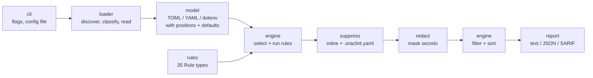

# Architecture

oraclint is a linear pipeline. Each stage is a small package with one job, and
data flows in one direction:

## Packages

| Package | Responsibility |
|---|---|
| `cmd/oraclint` | `main` only: build metadata and `cli.Execute`. Also hosts the testscript end-to-end tests. |
| `internal/cli` | cobra commands (`scan`, `rules list`, `rules explain`, `version`), flag validation, exit codes, color detection. |
| `internal/loader` | Finds files (walk through `os.Root`), classifies them by name and content, enforces the size limit, parses them into `model.Target`s, collects `oraclint:ignore` directives. Problems become `ParseError`s instead of aborting the scan. |
| `internal/model` | Position-aware document model. `Value` (TOML tree with a `Location` per key), `Field` (effective value: explicit or node default), `defaults.go` (every default rules rely on, with sources), `Merge` (node override semantics), YAML helpers that follow aliases at most once, dotenv parser, directive parser. |
| `internal/rules` | The `Rule` interface, `Severity`/`Status`, the explicit registry and one file per rule. Rules are pure functions of a `Target`. Shared helpers: host classification, compose services and ports, Kubernetes pod specs, environment variables, image references. |
| `internal/engine` | Selects rules (stable / experimental / enable / disable), runs them on the targets they apply to, turns loader problems into `parse-error` findings, applies suppressions, redacts messages, filters by severity and sorts deterministically. |
| `internal/suppress` | Parses and validates `.oraclint.yaml`; applies config and inline suppressions; reports invalid directives. |
| `internal/redact` | Collects known secrets from targets and masks them plus secret-looking patterns in any text. |
| `internal/report` | Text, JSON (versioned schema) and SARIF 2.1.0 writers. |
| `docs` | Embeds `docs/rules/*.md` into the binary for `rules explain` and SARIF help. |

## The path of `oraclint scan`

1. `cli/scan.go` parses flags, loads `.oraclint.yaml`, and builds
   `engine.Options` (severity threshold, rule selection, suppressions).
2. `loader.Load` handles forced files (`--config` etc.; repeated `--config`
   files are merged with `model.Merge`), then walks each directory through an
   `os.Root`. `classifyByName` picks a parser; content decides the kind for
   generic `*.toml`/`*.yaml` files (`classifyTOML`, `looksLikeK8s`).
3. `model.ParseTOML` decodes values with go-toml and records key positions
   with go-toml's low-level parser; `ParseYAML` keeps `yaml.Node` trees;
   `ParseEnv` handles dotenv files.
4. `engine.Run` calls `Check` on every selected rule whose `Targets` include
   the target's kind. Rules read effective values with `TOMLDoc.Get`, which
   returns the node default and the nearest location when a key is absent.
5. `suppress.Apply` marks suppressed findings and reports invalid directives.
6. `redact.Collect` registers every secret found in the targets; each message
   and suppression reason passes through `Redactor.Apply`.
7. Findings are filtered by `--min-severity` and sorted by file, line, column,
   rule ID and message.
8. `report.Write` renders the chosen format into memory, which is then written
   to stdout or `--output`. The exit code is 1 if any unsuppressed finding is at
   or above `--fail-on`.

## Adding a rule

1. **Verify** the key name, default and behavior in the node source at the
   target version (see `docs/research.md`). If it cannot be verified, mark the
   rule `Experimental` or do not write it.
2. If the rule depends on a default, add it to `internal/model/defaults.go`
   with its source.
3. Create `internal/rules/<name>.go` with an empty struct implementing
   `Metadata()` and `Check()`. Use `newFinding`; never put a value from the
   file into the message (key names, hosts and identifiers only).
4. Add a table-driven `internal/rules/<name>_test.go`: positive, negative,
   absent key (default), boundary values, multiple occurrences, and that the
   message contains no secret.
5. Add fixtures: `testdata/<ID>/vulnerable/*` (must fire) and
   `testdata/<ID>/safe/*` (must not). Multi-target rules use a `<kind>-` file
   name prefix.
6. Write `docs/rules/<ID>.md` with the standard sections.
7. Add the rule to `rules.All()` in `registry.go`.
8. Make `examples/insecure-node` trigger it and keep `examples/hardened-node`
   clean.
9. Run `make golden-update` (SARIF golden file and README rule table) and
   review the diff, then `make test-race lint`.

The registry, fixture and documentation tests fail if any step is missing.

## Key decisions

| Decision | ADR |
|---|---|
| Rules verified against one pinned node version | [0002](adr/0002-target-node-version.md) |
| go-toml with two passes for values and positions | [0003](adr/0003-toml-parsing-and-positions.md) |
| `go.yaml.in/yaml/v3`, `yaml.Node`, no alias expansion | [0004](adr/0004-yaml-library.md) |
| Discovery, classification, `os.Root`, config merging | [0005](adr/0005-file-discovery-and-merging.md) |
| Rules as Go types, explicit registry, contract tests | [0006](adr/0006-rule-design.md) |
| Two-layer secret redaction | [0007](adr/0007-secret-redaction.md) |
| Hand-written SARIF and colors, schema-validated | [0008](adr/0008-output-formats.md) |
| Exit codes, thresholds, mandatory-reason suppressions | [0009](adr/0009-cli-contract-and-suppressions.md) |
